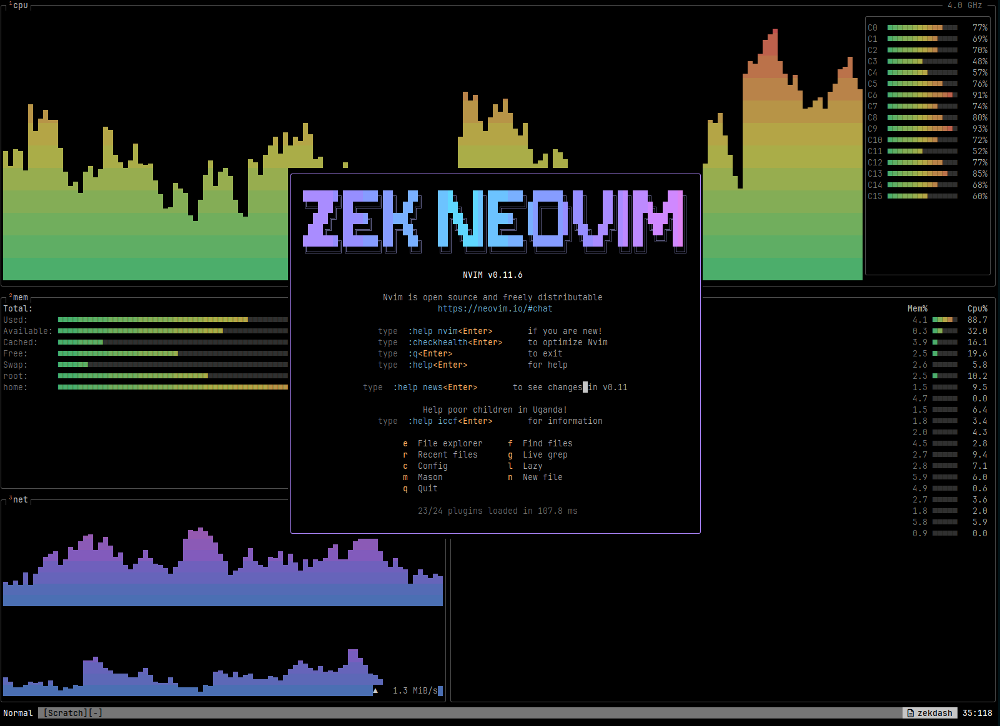

# Zek Neovim

My personal Neovim config, grown from [kickstart.nvim](https://github.com/nvim-lua/kickstart.nvim).
It's built around **jk magic**: your fingers stay on `j` and `k` for almost everything.



## ✨ jk magic

`j` and `k` already move down and up. This config uses the same two keys for nearly every
"down/up", "next/previous" and "get me out of here" action, everywhere in the editor.

| Keys | Where | What it does |
| :--- | :---- | :----------- |
| `jk` | Insert | Exit insert mode (no reaching for `<Esc>`) |
| `j` / `k` | Normal | Line down / up, with relative line numbers so `5j` / `12k` are easy to count |
| `J` / `K` | Normal, Visual | Jump to next / previous paragraph |
| `<C-j>` / `<C-k>` | Normal | Move focus to the window below / above |
| `<C-j>` / `<C-k>` | Terminal | Leave terminal mode and move to the window below / above |
| `<C-j>` / `<C-k>` | Completion menu | Select next / previous suggestion (`<CR>` accepts) |
| `<C-j>` / `<C-k>` | Telescope | Next / previous result |

Because `J` and `K` now move between paragraphs, the keys they used to have moved:

| Keys | What it does | Replaces |
| :--- | :----------- | :------- |
| `{` | Join lines | `J` |
| `}` | LSP hover documentation | `K` |

`<C-h>` / `<C-l>` complete the set for left/right windows in normal and terminal mode.

## Features

- **Animated start screen**: btop-style cpu/mem/net/proc panels animate behind a gradient
  **ZEK NEOVIM** logo, the usual `:intro` info and quick-action keys. Reopen it with `:ZekDash`.
- **LSP** via `nvim-lspconfig` + Mason using Neovim 0.11's `vim.lsp.config` / `vim.lsp.enable`
  (`lua_ls` and `jdtls` out of the box).
- **Java** via [nvim-java](https://github.com/nvim-java/nvim-java) (jdtls runtime from `$JAVA_HOME`).
- **Godot / GDScript** treesitter parsers (`gdscript`, `godot_resource`, `gdshader`).
- **Completion** with [blink.cmp](https://github.com/Saghen/blink.cmp) + LuaSnip, docs pop up automatically.
- **Fuzzy finding** with Telescope (fzf-native, ui-select).
- **Formatting on save** with conform.nvim (stylua for Lua, LSP fallback elsewhere).
- **Markdown rendered in the buffer** with [render-markdown.nvim](https://github.com/MeanderingProgrammer/render-markdown.nvim).
- **Git hunks** with gitsigns, **file explorer** with mini.files, **statusline** with mini.statusline,
  pending-key hints with which-key, highlighted TODOs with todo-comments.
- Built-in `lunaperche` colorscheme, tabs for indentation (width 4), system clipboard, persistent undo.
- Plugin versions pinned in `lazy-lock.json`.

## Requirements

- Neovim **0.11+**
- `git`, `make`, `unzip`, a C compiler (`gcc`)
- [`tree-sitter` CLI](https://github.com/tree-sitter/tree-sitter/blob/master/crates/cli/README.md) (nvim-treesitter's `main` branch builds parsers with it)
- [ripgrep](https://github.com/BurntSushi/ripgrep#installation) for live grep
- A clipboard tool (`xclip`, `xsel`, `wl-clipboard` or `win32yank`)
- A [Nerd Font](https://www.nerdfonts.com/) (`vim.g.have_nerd_font = true` in `init.lua`)
- A JDK with `JAVA_HOME` set, for Java

## Installation

Back up any existing config first, then clone into your Neovim config directory:

```sh
# Linux / macOS
git clone https://github.com/ezekielbaniaga/zek-windows-kickstart.nvim.git "${XDG_CONFIG_HOME:-$HOME/.config}"/nvim
```

```powershell
# Windows (PowerShell)
git clone https://github.com/ezekielbaniaga/zek-windows-kickstart.nvim.git "$env:LOCALAPPDATA\nvim"
```

Start `nvim`. lazy.nvim installs every plugin on first launch. Run `:Lazy restore` to match the
versions in `lazy-lock.json`, and `:checkhealth` if anything looks off.

## Keymaps

The leader key is `<Space>`. Press it and wait to see every group in which-key.

### Start screen

| Key | Action | Key | Action |
| :-- | :----- | :-- | :----- |
| `e` | File explorer | `f` | Find files |
| `r` | Recent files | `g` | Live grep |
| `c` | Config files | `l` | Lazy |
| `m` | Mason | `n` / `i` | New file |
| `q` | Quit | | |

### General

| Keys | Action |
| :--- | :----- |
| `<leader>w` | Save |
| `<leader>x` | Save and close |
| `<leader>q` | Close |
| `<leader>e` | File explorer (mini.files, `<CR>` opens a file) |
| `<leader>z` | Terminal in a vertical split |
| `<Esc><Esc>` | Leave terminal mode |
| `<Esc>` / `<leader>nh` | Clear search highlight |
| `x` | Delete a character without yanking it |
| `q`, `Q` | Disabled (no accidental macro recording / Ex mode) |
| `[d` / `]d` | Previous / next diagnostic |
| `<leader>m` | Toggle rendered / raw markdown |

### Splits (`<leader>s`)

| Keys | Action | Keys | Action |
| :--- | :----- | :--- | :----- |
| `<leader>sv` | Split vertically | `<leader>sh` | Split horizontally |
| `<leader>se` | Equalize sizes | `<leader>sm` | Maximize |
| `<leader>sq` | Close split | `<leader>sx` | Swap with next |
| `<leader>sw` | Switch windows | `<leader>st` | Move split to a new tab |
| `<leader>s+` / `<leader>s-` | Taller / shorter | `<leader>s>` / `<leader>s<` | Wider / narrower |

### Tabs (`<leader>t`)

| Keys | Action |
| :--- | :----- |
| `<leader>to` | New tab |
| `<leader>tx` | Close tab |
| `<leader>tn` / `<leader>tp` | Next / previous tab |

### Find (`<leader>f`, Telescope)

| Keys | Action | Keys | Action |
| :--- | :----- | :--- | :----- |
| `<leader>ff` | Files | `<leader>fg` | Live grep |
| `<leader>fw` | Word under cursor | `<leader>f/` | Grep in open files |
| `<leader>f.` | Recent files | `<leader>fb` | Buffers |
| `<leader>fa` / `<leader>/` | Search current buffer | `<leader>fs` | Git status |
| `<leader>fd` | Diagnostics | `<leader>fr` | Resume last search |
| `<leader>fh` | Help | `<leader>fk` | Keymaps |
| `<leader>fn` | Neovim config files | `<leader>fc` | Colorschemes |
| `<leader>fz` | All Telescope pickers | `<leader>fp` | Planets 🪐 |

Inside Telescope: `<C-j>` / `<C-k>` move, `<C-f>` / `<C-b>` scroll the preview, `<Esc>` closes.

### LSP (when a language server is attached)

| Keys | Action | Keys | Action |
| :--- | :----- | :--- | :----- |
| `}` | Hover documentation | `grn` | Rename |
| `gra` | Code action | `grd` | Go to definition |
| `grr` | References | `gri` | Implementations |
| `grt` | Type definition | `grD` | Declaration |
| `gO` | Document symbols | `gW` | Workspace symbols |

### Completion (blink.cmp)

| Keys | Action |
| :--- | :----- |
| `<C-j>` / `<C-k>` | Next / previous item |
| `<CR>` | Accept |

### Git hunks (`<leader>h`, gitsigns)

| Keys | Action | Keys | Action |
| :--- | :----- | :--- | :----- |
| `<leader>h]` / `<leader>h[` | Next / previous hunk | `<leader>hp` | Preview hunk |
| `<leader>hs` | Stage / unstage hunk (works in visual) | `<leader>hr` | Reset hunk (works in visual) |
| `<leader>hS` | Stage buffer | `<leader>hR` | Reset buffer |
| `<leader>hb` | Blame line | `<leader>hz` | Toggle line blame |
| `<leader>ht` | Inline preview of deleted lines | `<leader>hd` / `<leader>hD` | Diff against index / last commit |

## Layout

```
init.lua                    options, keymaps and all plugin specs
lua/custom/dashboard.lua    the animated start screen
lua/custom/plugins/         drop-in spot for extra plugin specs
lua/kickstart/health.lua    :checkhealth kickstart
lazy-lock.json              pinned plugin versions
```

## Credits

Started from [kickstart.nvim](https://github.com/nvim-lua/kickstart.nvim) by TJ DeVries and contributors.
Licensed under MIT, see [LICENSE.md](LICENSE.md).
